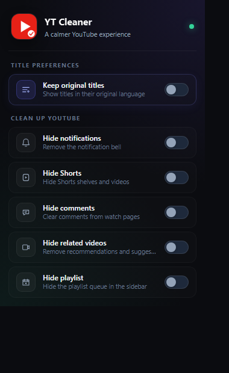

# YT Cleaner

YT Cleaner keeps original YouTube titles and cleans noisy UI elements such as notifications, Shorts, comments, related videos, and playlists.

[](./LICENSE)
[](https://github.com/M003aad/YT-Cleaner/releases)
[](https://developer.chrome.com/docs/extensions/mv3/)
[](https://github.com/M003aad/YT-Cleaner/actions/workflows/ci.yml)

## Table of contents

- [Overview / Architecture](#overview--architecture)
- [Features](#features)
- [Screenshots](#screenshots)
- [Codebase breakdown](#codebase-breakdown)
- [Permissions](#permissions)
- [Installation & setup](#installation--setup)
- [Usage](#usage)
- [Scripts](#scripts)
- [Contributing](#contributing)
- [Security](#security)
- [License](#license)

## Overview / Architecture

YT Cleaner is a Manifest V3 browser extension that modifies the YouTube web experience without changing the platform's account settings or user subscriptions. The project is built from plain JavaScript and uses browser extension APIs such as `chrome.storage.sync`, `chrome.tabs`, and content scripts.

The extension is split into a few distinct pieces:

- `interceptor.js` runs in the page's `MAIN` world and watches `fetch` and `XMLHttpRequest` calls for YouTube API responses.
- `content.js` runs in the isolated world and toggles the cleanup classes on the page while also signaling the main-world interceptor when original titles are enabled.
- `popup.html`, `popup.css`, and `popup.js` provide the extension popup and save preference state in `chrome.storage.sync`.
- `cleaner.css` contains the hide rules used to remove Shorts, comments, related videos, notification counts, and playlist panels.

The main feature is a title rewrite flow: when YouTube provides translated metadata, the extension hits YouTube's oEmbed endpoint for the original title and patches the page data before the UI is rendered.

## Features

The implemented features currently in the codebase are:

- Keep original YouTube titles in their original language when a translated title is returned.
- Hide the notification bell and strip notification counts from the tab title.
- Hide Shorts shelves, navigation entries, videos, and shortcut channels.
- Hide comments on watch pages.
- Hide related videos, recommendations, and in-player suggestion panels.
- Hide playlist panels and center the player when playlist and related-video cleanup are both enabled.
- Cache resolved original titles in `localStorage` to avoid repeated lookups.
- Persist user preferences across browser sessions using `chrome.storage.sync`.

## Screenshots

### Settings popup



## Codebase breakdown

```text
YT-Cleaner/
├── .github/
│   ├── ISSUE_TEMPLATE/
│   │   ├── bug_report.md
│   │   └── feature_request.md
│   ├── PULL_REQUEST_TEMPLATE.md
│   └── workflows/
│       ├── ci.yml
│       └── release.yml
├── icons/
│   ├── icon16.png
│   ├── icon32.png
│   ├── icon48.png
│   └── icon128.png
├── screenshots/
│   └── popup.png
├── .editorconfig
├── .gitattributes
├── .gitignore
├── .prettierrc
├── CHANGELOG.md
├── CITATION.cff
├── CODE_OF_CONDUCT.md
├── CONTRIBUTING.md
├── SECURITY.md
├── SUPPORT.md
├── README.md
├── cleaner.css
├── content.js
├── eslint.config.js
├── interceptor.js
├── LICENSE
├── manifest.json
├── package.json
├── popup.css
├── popup.html
├── popup.js
└── SUMMARY.md
```

| File or folder | Purpose |
| --- | --- |
| `.github/` | Issue templates, pull request template, and CI/release automation. |
| `icons/` | Extension icons used in the popup and browser UI. |
| `content.js` | Isolated-world content script that applies the enabled cleanup classes and triggers title restoration. |
| `interceptor.js` | Main-world script that intercepts YouTube page data, rewrites translated titles, and caches original titles. |
| `cleaner.css` | CSS selectors for hiding notifications, Shorts, comments, playlist panels, and related content. |
| `popup.html` | The settings popup layout for the extension. |
| `popup.css` | Styling for the popup UI. |
| `popup.js` | Handles all popup interactions and persists user preferences. |
| `manifest.json` | Extension manifest with host permissions, popup configuration, and content script registration. |
| `LICENSE` | AGPL-3.0 license for the project. |
| `package.json` | Linting and validation scripts used in local development and CI. |

## Permissions

The extension requests the permissions listed in `manifest.json`.

| Permission | Why it is needed |
| --- | --- |
| `storage` | Persists the user's choices for original titles and cleanup options across browser sessions. |
| `*://www.youtube.com/*` | Allows the extension to intercept YouTube page data and patch displayed titles. |
| `*://m.youtube.com/*` | Allows the extension to work on YouTube's mobile web pages. |

## Installation & setup

1. Clone the repository:

   ```bash
   git clone https://github.com/M003aad/YT-Cleaner.git
   cd YT-Cleaner
   ```

2. Install the development tooling:

   ```bash
   npm install
   ```

3. Validate the repository before testing:

   ```bash
   npm run lint
   npm run check
   npm run validate
   ```

4. Load the extension in your browser:
   - Open `chrome://extensions/` or `edge://extensions/`.
   - Enable Developer mode.
   - Select **Load unpacked**.
   - Choose the project root that contains `manifest.json`.

5. Open or refresh a YouTube tab to test the extension.

The extension is designed to run on YouTube domains covered by the manifest: `www.youtube.com` and `m.youtube.com`.

## Usage

After loading the extension, open the YT Cleaner popup and toggle the available settings:

- **Keep original titles**: restores original uploaded titles when YouTube provides translated metadata.
- **Hide notifications**: removes the notification bell and strips the badge count from the page title.
- **Hide Shorts**: hides Shorts shelves, Short links, and related Short content.
- **Hide comments**: removes comments from watch pages.
- **Hide related videos**: removes recommended video suggestions and sidebar content.
- **Hide playlist**: hides the playlist panel and re-centers the player when combined with related-video cleanup.

Toggling **Keep original titles** reloads open YouTube tabs so the new title behavior is applied.

## Scripts

The project includes the following scripts in `package.json`:

| Script | Purpose |
| --- | --- |
| `npm run lint` | Runs ESLint against the JavaScript files. |
| `npm run format` | Formats the repository with Prettier. |
| `npm run check` | Performs syntax validation with Node's parser on the extension scripts. |
| `npm run validate` | Validates that the extension manifest is present and compatible with Manifest V3. |

## Contributing

Contributions are welcome. Please read [CONTRIBUTING.md](./CONTRIBUTING.md) for the development workflow, bug-report guidelines, and pull request expectations.

## Security

Please review [SECURITY.md](./SECURITY.md) before reporting vulnerabilities or security concerns. The project uses GitHub Private Vulnerability Reporting when available, and the maintainer can also be reached at `188705139+M003aad@users.noreply.github.com`.

## License

YT Cleaner is distributed under the GNU Affero General Public License v3.0 or later. See the [LICENSE](./LICENSE) file for the full text.

Maintained by M003aad.
